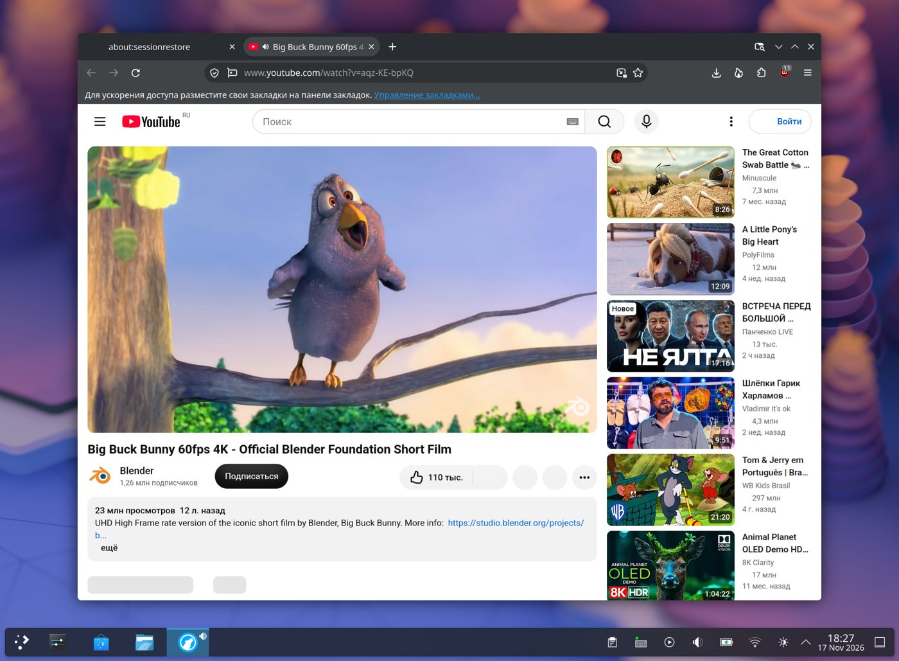

# Браузер на планшете: LibreWolf (и почему не Firefox из apt)

Обновлено: 17.11.2026. Плата: Ubuntu 26.04 LTS, ядро `6.12.114-wifi1`,
KDE Plasma 6 на Wayland, root-сессия, 3.5 ГиБ RAM.

## Итог

На планшет поставлен **LibreWolf 160.0** (arm64 `.deb` из `repo.librewolf.net`).
Он работает нативно под Wayland, YouTube грузится и играет:
`Big Buck Bunny 4K 60fps` (VP9, программный декод) — кадры идут, звук/DRM не
проверялись. Проверка — скриншотами с самой панели:



Ubuntu-пакеты `firefox` и `chromium-browser` на этой плате **не работают**:
это заглушки, которые ставят snap, а snapd не может смонтировать свой образ
(подробности ниже). Поставлено и исправлено четыре отдельные проблемы — snap,
локали, окружение GUI-запуска по ssh и профиль браузера под 3.5 ГиБ RAM.

## 1. `apt install firefox` → ошибка dpkg (snap + squashfs)

Что в архиве Ubuntu 26.04 (`apt-cache policy`):

```
firefox:          1:1snap1-0ubuntu8   (переходный пакет: внутри только вызов snap)
chromium-browser: 2:1snap1-0ubuntu4   (то же)
```

Установка падает на этапе распаковки, ещё до какого-либо UI:

```
=> Installing the firefox snap
==> Checking connectivity with the snap store
error: system does not fully support snapd: cannot mount squashfs image using
       "squashfs": ----- mount: /tmp/syscheck-mountpoint-3434923076: wrong
       fs type, bad option, bad superblock on /dev/loop0, missing codepage or
       helper program, or other error.
dpkg: error processing archive .../firefox_1%3a1snap1-0ubuntu8_arm64.deb (--unpack)
```

Причина — не сеть и не сам snapd (`snapd.service` активен, `snapd` 2.74.1
установлен): в ядре включён **только zlib** внутри squashfs.

```
$ zcat /proc/config.gz | grep ^CONFIG_SQUASHFS_
CONFIG_SQUASHFS_ZLIB=y
# а XZ / LZ4 / LZO / ZSTD — не заданы
```

Диагноз проверен прямым опытом: с хоста собраны три одинаковых образа разного
сжатия и смонтированы на планшете (loop есть, `squashfs` в `/proc/filesystems`
есть):

| образ | `mount -t squashfs -o loop` |
|---|---|
| `-comp gzip` | ok, файл читается |
| `-comp xz` | `wrong fs type, bad option, bad superblock on /dev/loop0` |
| `-comp zstd` | то же самое |

`mksquashfs` по умолчанию (и snapd при сборке snap-образов) использует
xz/zstd — отсюда ровно та ошибка, что печатает dpkg.

**Исправление:** (а) snap не используем — браузер ставим настоящим `.deb`;
(б) в `configs/t1100.fragment` добавлены `CONFIG_SQUASHFS_{XZ,LZ4,LZO,ZSTD}=y` —
это разблокирует и snapd, но подействует только после пересборки ядра и
прошивки boot (в этой сессии не делалось: прошивка — только с бэкапом и
подтверждением).

После сбоя dpkg пакет остаётся в состоянии `in` (не `ii`); чистится так:

```sh
dpkg --remove --force-remove-reinstreq firefox
apt-get -f install -y
```

## 2. Установка LibreWolf (репозиторий + проверка ключа)

Автоматически: `tools/host/librewolf-install.sh` (ставит ключ, репозиторий,
пакет и `user.js` в профили). Вручную — то же самое:

```sh
install -d -m 0755 /etc/apt/keyrings
python3 -c 'import urllib.request;open("/etc/apt/keyrings/librewolf.gpg","wb").write(
    urllib.request.urlopen("https://repo.librewolf.net/keyring.gpg",timeout=60).read())'
sha256sum /etc/apt/keyrings/librewolf.gpg      # 8398142ed02480bf…f11ce4560
gpg --show-keys --with-fingerprint /etc/apt/keyrings/librewolf.gpg
#   pub rsa4096 2022-05-14
#       662E 3CDD 6FE3 2900 2D0C  A5BB 4033 9DD8 2B12 EF16   ← сверять
echo 'deb [signed-by=/etc/apt/keyrings/librewolf.gpg] https://repo.librewolf.net librewolf main' \
    > /etc/apt/sources.list.d/librewolf.list
apt-get update && apt-get install -y librewolf
```

Факты прогона: загрузка 150 МБ за 49 с (≈3.0 МБ/с по встроенному Wi-Fi),
`Installed-Size` 453 637 КБ, пакет `librewolf 160.0-1 arm64`, `update-alternatives`
ставит его как `x-www-browser`. Репозиторий собирает и amd64, и arm64
(`Architectures: amd64 arm64` в `InRelease`), так что это не «x86-only» сборка.

Зачем именно LibreWolf: это Firefox с выключенной телеметрией, встроенным
uBlock Origin и ужесточёнными `defaultPref` (в т.ч. блокировка autoplay,
выключенные `media.eme`/Widevine, `privacy.resistFingerprinting`). Для «анонимно
и безопасно, но чтобы YouTube работал» — ровно то: YouTube не требует DRM,
а Firefox-движок умеет VP9/AV1 без проприетарных кодеков.

## 3. Ошибка локалей (её видно и в apt, и в браузере)

Каждый вызов `apt`/`dpkg` и сам браузер печатали:

```
locale: Cannot set LC_CTYPE to default locale: No such file or directory
[Main Thread] WARNING: Locale not supported by C library.
        Using the fallback 'C' locale.
```

Причина: `LANG=ru_RU.UTF-8` в окружении есть, а пакета `locales` в образе нет —
`/usr/lib/locale` содержал только `C.utf8`. Браузер из-за этого уходил на
`C`-локаль (сортировка, форматы дат, спеллчек).

Исправление (и оно же добавлено в `configs/rootfs-packages.txt`, чтобы не
повторялось при сборке образа):

```sh
apt-get install -y --no-install-recommends locales
sed -i -e 's/^# *\(ru_RU.UTF-8 UTF-8\)/\1/' -e 's/^# *\(en_US.UTF-8 UTF-8\)/\1/' /etc/locale.gen
locale-gen                       # ru_RU.UTF-8... done, en_US.UTF-8... done
printf 'LANG=ru_RU.UTF-8\nLANGUAGE=ru\n' > /etc/default/locale
```

После этого `locale` печатает `LC_CTYPE="ru_RU.UTF-8"`, а в логе браузера
строк «Locale not supported» — 0 (проверено `grep -c`).

## 4. Запуск GUI-программы по ssh: нужен `WAYLAND_DISPLAY`

Из ssh-сессии браузер не стартует:

```
Error: no DISPLAY environment variable specified
```

Окружение сессии лежит в `/proc/<kwin_wayland>/environ` и содержит
`XDG_RUNTIME_DIR=/run/user/0`, `DBUS_SESSION_BUS_ADDRESS=unix:path=/run/user/0/bus`,
но **не содержит `WAYLAND_DISPLAY`** — сокет создаёт сам kwin, переменной у него
нет. Имя сокета надо взять из каталога: `ls $XDG_RUNTIME_DIR | grep ^wayland-`.

Готовый запуск (сам находит kwin, вытаскивает env, умеет скриншот):

```sh
tools/host/session-run.sh librewolf https://www.youtube.com/     # запустить
tools/host/session-run.sh --shot /tmp/shot.png true              # снять экран
```

Два побочных грабля из той же сессии:

- **`pkill -f librewolf` по ssh убивает саму ssh-сессию** — в её командной
  строке тоже есть слово `librewolf`. Использовать `pkill -x librewolf`.
- **Экран блокируется**, и скриншот показывает лок-скрин вместо браузера
  (`loginctl show-session 1 -p LockedHint` → `yes`). Для съёмки:
  `loginctl unlock-sessions` (root), а авто-блокировку на время тестов
  отключает `kwriteconfig6 --file kscreenlockerrc --group Daemon --key Autolock false`.

## 5. Профиль браузера под 3.5 ГиБ и Mali-G72

Настройки лежат в образе: `rootfs-overlay/etc/librewolf/user.js` →
на плате `/etc/librewolf/user.js`, а `t1100-browser-prefs.service` при загрузке
раскладывает их в профили как `user.js` (`configs/librewolf-user.js` — симлинк
на файл в overlay; после правки — `systemctl start t1100-browser-prefs`).

| pref | зачем |
|---|---|
| `dom.ipc.processCount=4` | первый запуск поднимал 12 content-процессов; на 3.5 ГиБ RAM это лишние ~470 МиБ |
| `webgl.disabled=true` | panfrost без DVFS, WebGL на планшете нужен редко; минус площадь атаки |
| `gfx.webrender.software=true`, `gfx.canvas.accelerated=false` | compositing и так программный — фиксируем явно |
| `privacy.spoof_english=1` | убирает диалог первого запуска «запрашивать английские версии страниц?» |
| `intl.accept_languages="ru-RU, ru, en-US, en"` | русский интерфейс сайтов |
| `browser.shell.checkDefaultBrowser=false` | без вопроса про браузер по умолчанию |

Замеры на проигрывании `Big Buck Bunny 4K 60fps` (VP9, софт-декод):
RSS всех процессов браузера ≈ **640 МиБ**, CPU ≈ **170 %** (два ядра из восьми),
свободно ≈ 970 МиБ. Для 720p/1080p нагрузка заметно ниже — это разумный режим.

## 6. Что проверено и что ограничено

Проверено на железе:

- окно LibreWolf рисуется композитором KWin нативно по Wayland
  (`/proc/<pid>/fd` → сокет `wayland-proxy`);
- YouTube: страница, превью, комментарии, воспроизведение (два скриншота с
  разницей 12 с дают разные кадры — видео идёт);
- sandbox контента включён (`-contentproc … -sandboxReporter`), AppArmor в
  этом ядре не загружен, unprivileged userns не ограничены — Firefox-sandbox
  работает без правок;
- переустановка/повторный запуск идемпотентны (`tools/host/librewolf-install.sh`
  прогнан дважды).

Ограничения:

- **DRM/Widevine выключен** (`media.eme.enabled=false`,
  `media.gmp-widevinecdm.enabled=false`) — Netflix, Spotify, Кинопоиск и прочие
  DRM-сервисы не пойдут. YouTube — идёт.
- **Аппаратного декодирования видео нет** (panfrost без VP9/AV1-декодера):
  4K60 тянет, но дорого; для комфорта — 720p.
- **Autoplay заблокирован** политикой LibreWolf (`media.autoplay.default=5`) —
  ролик стартует после клика по ▶. Разрешить автозапуск:
  `user_pref("media.autoplay.default", 0);`.
- **Звук не проверялся** (аудио-тракт MT6771 в проекте вне скоупа v1); sink'и
  в PipeWire есть (`alsa_speaker`).
- **panfrost пишет `DATA_INVALID_FAULT`** при обновлении кадров: на видео ~16
  строк за 35 с, на статичной странице 0–1, при простое 0. `LIBGL_ALWAYS_SOFTWARE=1`
  число не меняет, картинка при этом корректная (кадры идут, артефактов нет).
  Это отдельная задача для `gpu-mesa` (V4L2/venus/софт-путь), не блокер.

## 7. Воспроизведение с нуля

```sh
tools/host/librewolf-install.sh          # репозиторий + ключ + пакет + user.js
tools/host/session-run.sh librewolf https://www.youtube.com/
```

Проверить, что всё на месте:

```sh
ssh root@10.42.66.66 'dpkg -l librewolf locales | tail -2; \
    grep -c user_pref /root/.config/librewolf/librewolf/*/user.js; \
    grep -c "Cannot set LC_\|Locale not supported" /tmp/lw.log 2>/dev/null'
```
